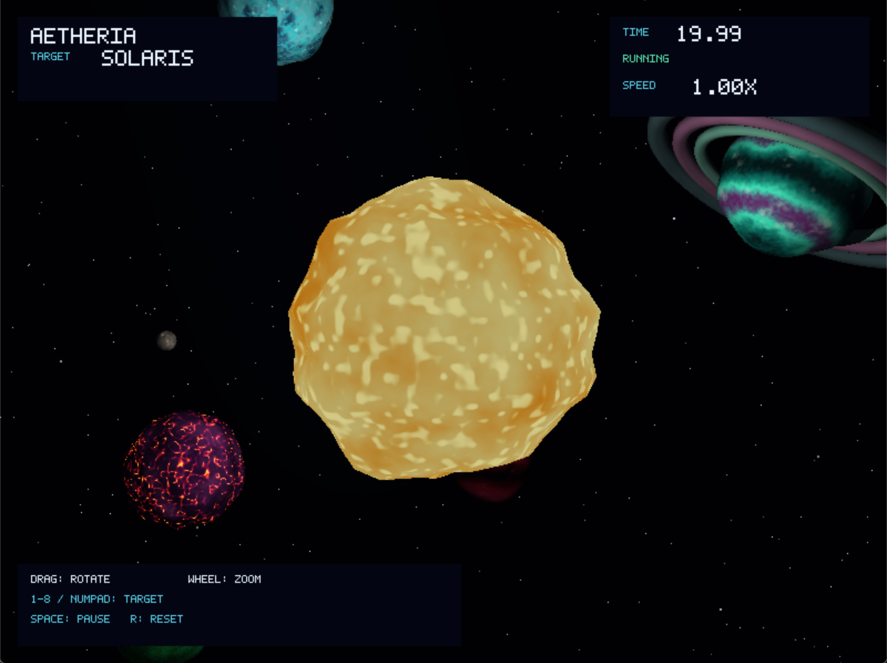
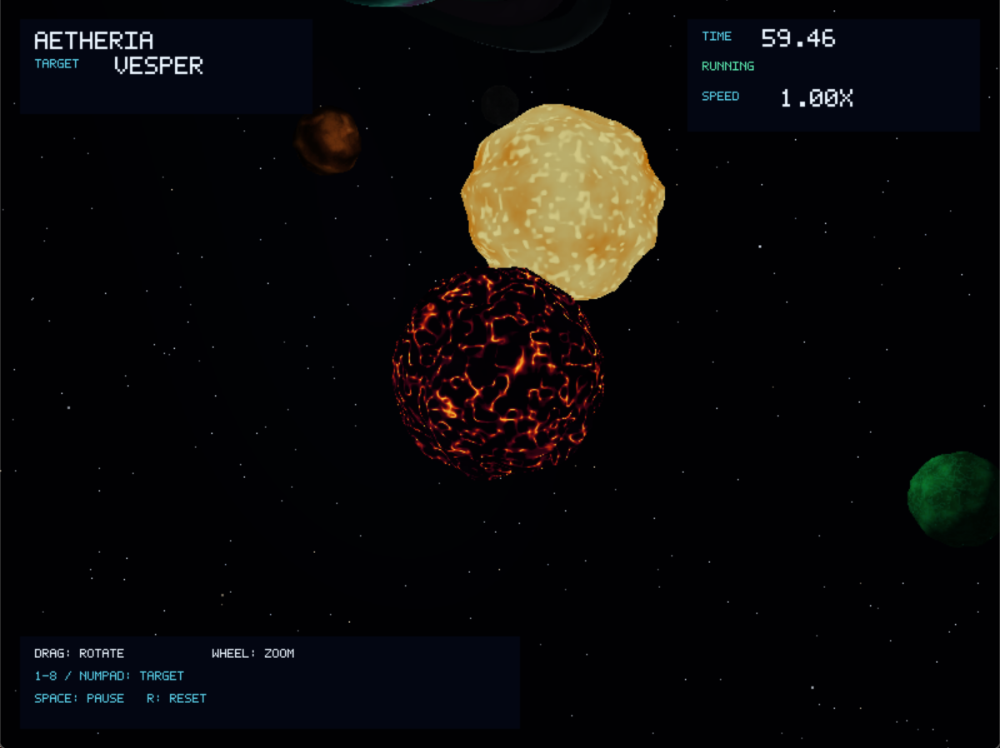
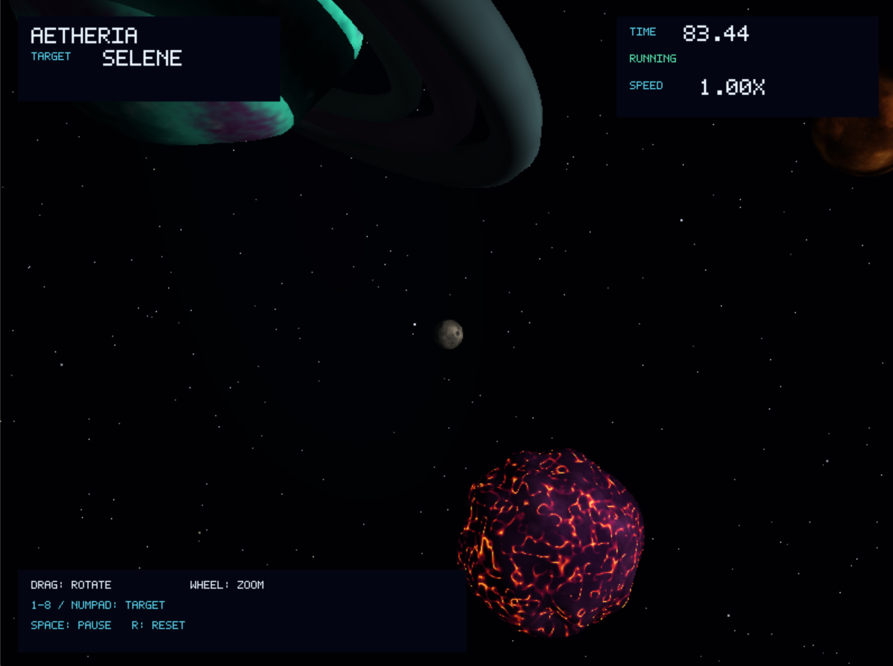
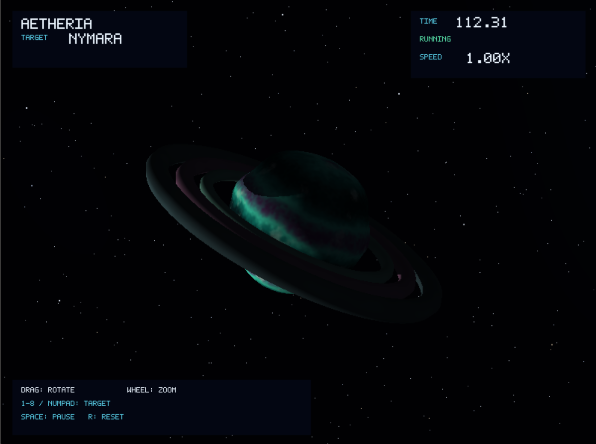
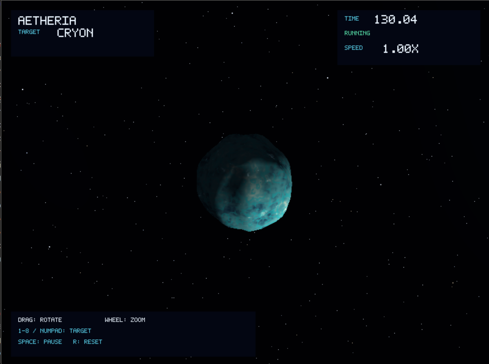
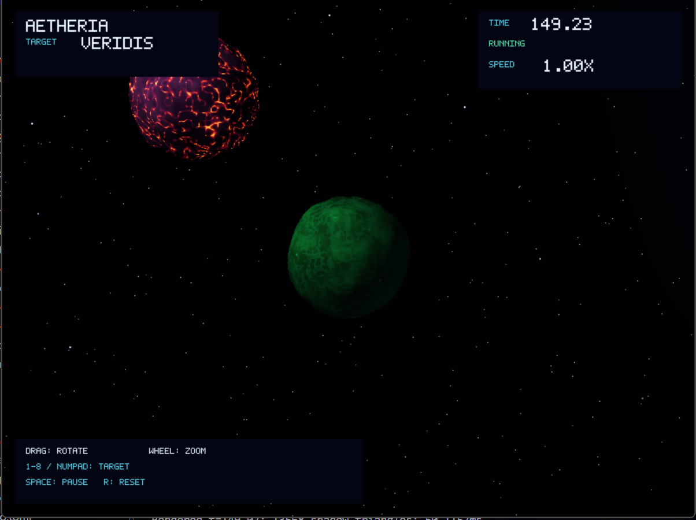
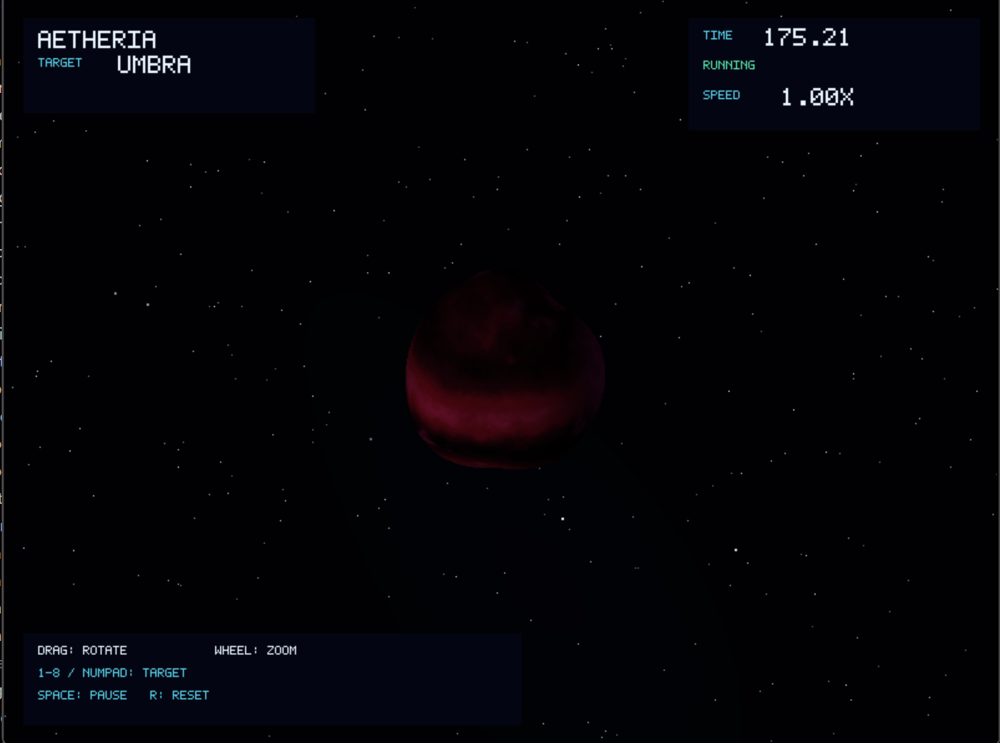
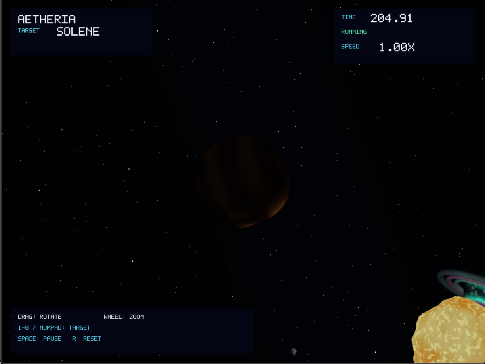

# AETHERIA — Lab-5-Shaders

Renderer CPU en Rust para un sistema solar estilizado. El proyecto carga modelos OBJ, aplica shaders procedurales por cuerpo celeste, calcula iluminación y sombras y puede mostrar el resultado en una ventana interactiva.

## Requisitos

- Rust y Cargo.
- Windows, Linux o macOS.
- Para la ventana interactiva, compilar con la feature `interactive`.

## Ejecutar el proyecto

Desde la raíz del repositorio:

```text
cargo run --release --features interactive -- --interactive
```

La ejecución normal carga los modelos OBJ de `assets/models/obj/`.

## Controles interactivos

| Control | Acción |
|---|---|
| `1` / `Numpad 1` | Enfocar Solaris |
| `2` / `Numpad 2` | Enfocar Vesper |
| `3` / `Numpad 3` | Enfocar Selene |
| `4` / `Numpad 4` | Enfocar Nymara |
| `5` / `Numpad 5` | Enfocar Cryon |
| `6` / `Numpad 6` | Enfocar Veridis |
| `7` / `Numpad 7` | Enfocar Umbra |
| `8` / `Numpad 8` | Enfocar Solene |
| Arrastre con botón izquierdo | Rotar la cámara alrededor del objetivo |
| Rueda del ratón | Acercar o alejar la cámara |
| `R` | Restablecer la cámara en Solaris |
| `Espacio` | Pausar o reanudar la simulación |
| `+` / `-` | Aumentar o reducir la velocidad |
| `N` | Avanzar un paso cuando la simulación está pausada |
| `Esc` | Cerrar la ventana |

La selección de objetivos se lee tanto por eventos de teclado como por el estado actual de la tecla para evitar perder pulsaciones durante frames pesados.

## Imágenes
Las capturas del proyecto están organizadas en [`assets/media/images/`](assets/media/images/).

| Captura | Vista |
|---|---|
|  | Sistema AETHERIA |
|  | Vista de Solaris |
|  | Vista de Vesper |
|  | Vista de Selene |
|  | Vista de Nymara |
|  | Vista de Cryon |
|  | Vista de Veridis |
|  | Vista de Umbra o Solene |

## Video

El video de demostración está en [`assets/media/video/`](assets/media/video/).

<video controls width="800" src="assets/media/video/20261108-1516-03.7388259.mp4" title="Demostración de AETHERIA"></video>